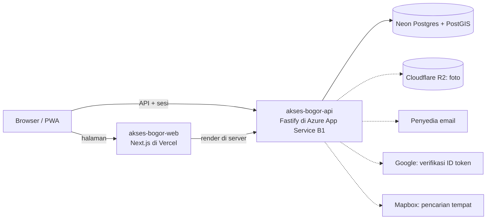
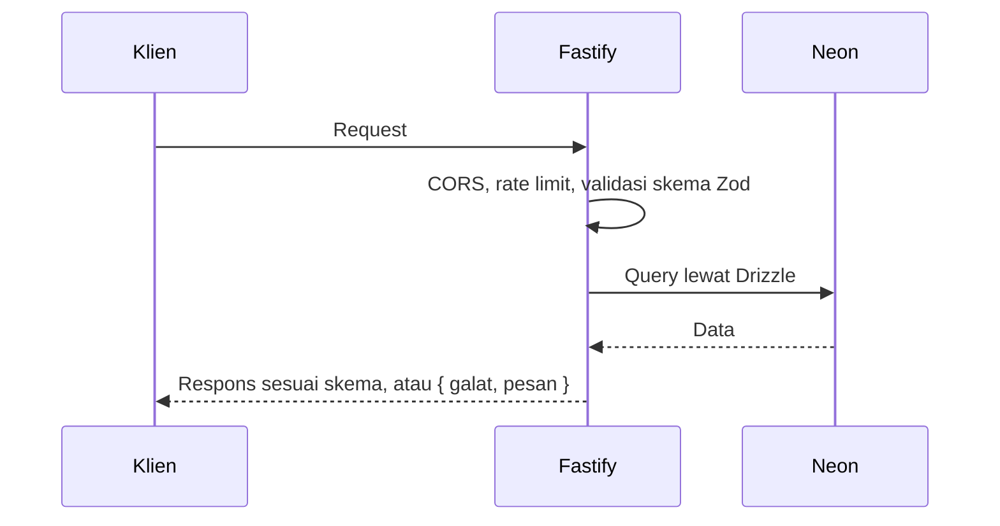
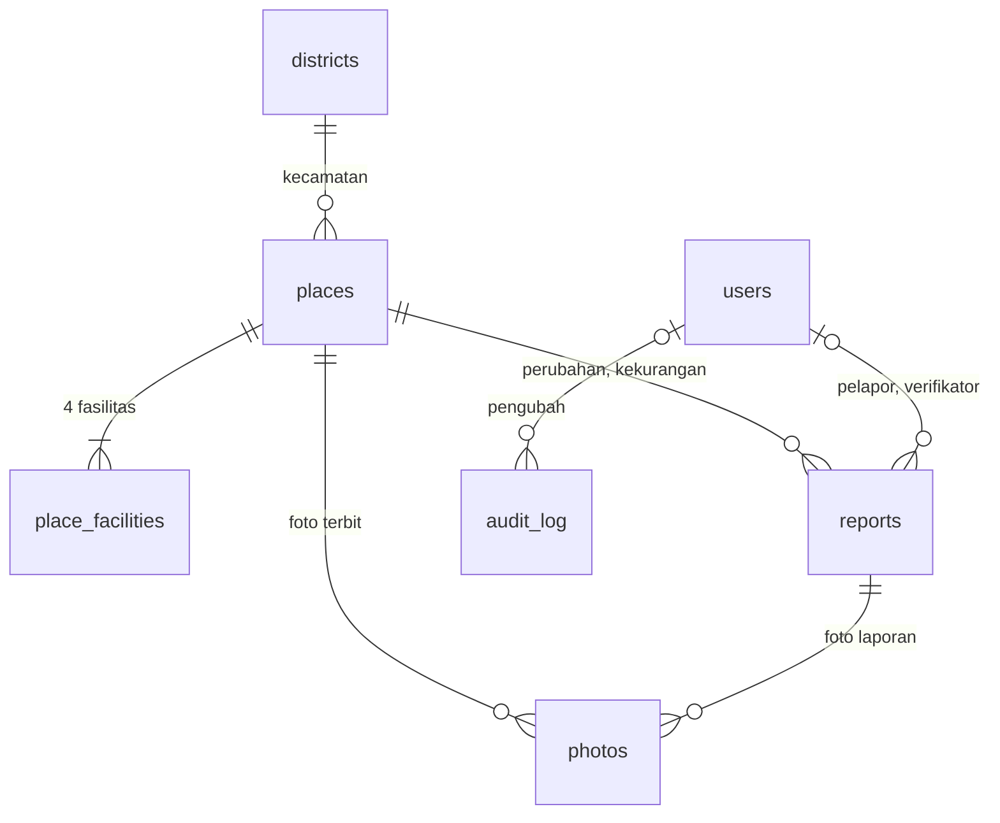

# Arsitektur

Sumber keputusan: [ADR-0013](https://github.com/al-dioooo/akses-bogor-docs/blob/main/decisions/0013-tech-stack-nextjs-fastify.md). Diagram di bawah memuat bagian yang sudah ada dan yang direncanakan; yang direncanakan ditandai garis putus-putus.

- Browser tidak pernah terhubung langsung ke database atau R2. Setiap request yang menyentuh data diperiksa sesi dan perannya di API.
- Aplikasi memakai koneksi pooled Neon (`DATABASE_URL`); migrasi memakai koneksi langsung (`DATABASE_URL_UNPOOLED`).
- Foto diperkecil di browser, lalu diperiksa ulang, disandikan ulang, dan dihapus metadata EXIF-nya di API sebelum disimpan ke R2 ([ADR-0023](https://github.com/al-dioooo/akses-bogor-docs/blob/main/decisions/0023-hingga-sepuluh-foto-bertag-per-laporan.md)).

## Alur Request

## Model Data

Mengikuti model data di [PRD bagian 9](https://github.com/al-dioooo/akses-bogor-docs/blob/main/product/prd.md). Skema ada di [src/db/schema.ts](../src/db/schema.ts), migrasi di [drizzle/](../drizzle).

| Tabel | Isi | Keputusan |
| --- | --- | --- |
| `districts` | Enam kecamatan Kota Bogor; batas wilayah (MultiPolygon) diimpor terpisah | ADR-0010 |
| `places` | Lokasi yang sudah terbit: kategori, titik (SRID 4326), patokan, deskripsi, status dan ringkasan fasilitas yang disimpan, tanggal verifikasi terakhir | ADR-0004, ADR-0015, ADR-0018 |
| `place_facilities` | Jawaban, alasan, dan catatan untuk setiap fasilitas; alasan hanya boleh ada saat Tidak tersedia | ADR-0017, ADR-0022 |
| `reports` | Laporan baru, perubahan, dan kekurangan dengan isian apa adanya, status verifikasi, alasan baku R1–R6, dan pertanyaan klarifikasi | ADR-0006, ADR-0019 |
| `photos` | Berkas di R2, tag objek, teks alternatif, keterangan, dan status moderasi | ADR-0023 |
| `users` | Nama tampilan, email (unik tanpa membedakan huruf besar), peran, waktu persetujuan privasi | ADR-0011, ADR-0014 |
| `audit_log` | Siapa mengubah apa dan kapan; pengubah kosong berarti akunnya sudah dihapus | FR-35, ADR-0024 |

Saat akun dihapus, `reporter_id` di laporan menjadi kosong (`ON DELETE SET NULL`); penghapusan laporan yang belum terbit dijalankan oleh aplikasi (ADR-0024).

## Struktur Folder

| Folder | Isi |
| --- | --- |
| `src/config` | Validasi environment variable |
| `src/db` | Klien Drizzle dan skema tabel |
| `drizzle` | Migrasi SQL hasil `pnpm db:generate` |
| `src/http` | Kelas galat dan skema respons galat |
| `src/routes` | Route Fastify, satu berkas per kelompok |
| `scripts` | Skrip pendukung, mis. pembuat `docs/openapi.json` |
| `test` | Tes Vitest dengan `app.inject`; tes database memakai PGlite + PostGIS di dalam proses |
| `docs` | Diagram ini dan API spec |
