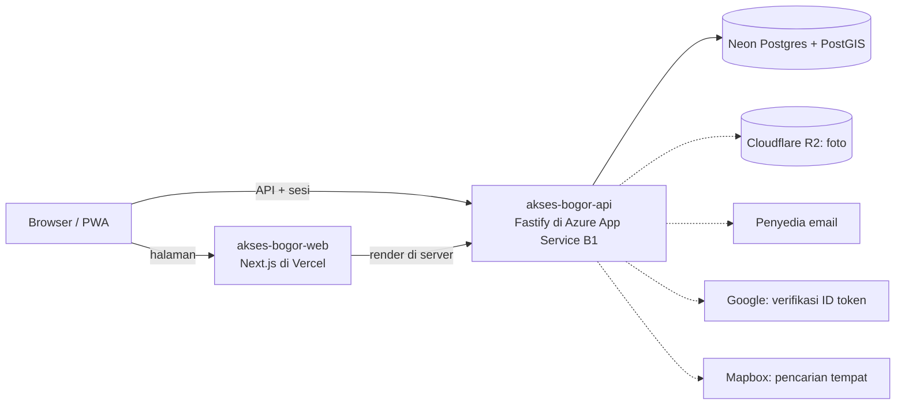
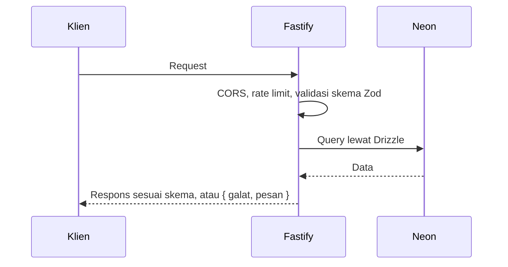

# Arsitektur

Sumber keputusan: [ADR-0013](https://github.com/al-dioooo/akses-bogor-docs/blob/main/decisions/0013-tech-stack-nextjs-fastify.md). Diagram di bawah memuat bagian yang sudah ada dan yang direncanakan; yang direncanakan ditandai garis putus-putus.

- Browser tidak pernah terhubung langsung ke database atau R2. Setiap request yang menyentuh data diperiksa sesi dan perannya di API.
- Aplikasi memakai koneksi pooled Neon (`DATABASE_URL`); migrasi memakai koneksi langsung (`DATABASE_URL_UNPOOLED`).
- Foto diperkecil di browser, lalu diperiksa ulang, disandikan ulang, dan dihapus metadata EXIF-nya di API sebelum disimpan ke R2 ([ADR-0023](https://github.com/al-dioooo/akses-bogor-docs/blob/main/decisions/0023-hingga-sepuluh-foto-bertag-per-laporan.md)).

## Alur Request

## Struktur Folder

| Folder | Isi |
| --- | --- |
| `src/config` | Validasi environment variable |
| `src/db` | Klien Drizzle dan skema tabel |
| `src/http` | Kelas galat dan skema respons galat |
| `src/routes` | Route Fastify, satu berkas per kelompok |
| `scripts` | Skrip pendukung, mis. pembuat `docs/openapi.json` |
| `test` | Tes Vitest dengan `app.inject` |
| `docs` | Diagram ini dan API spec |
